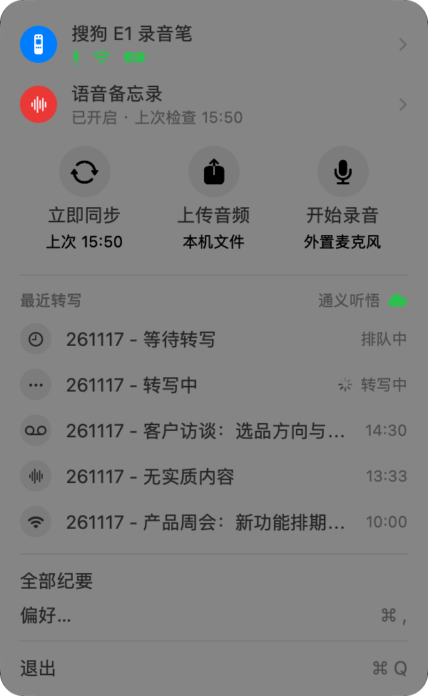
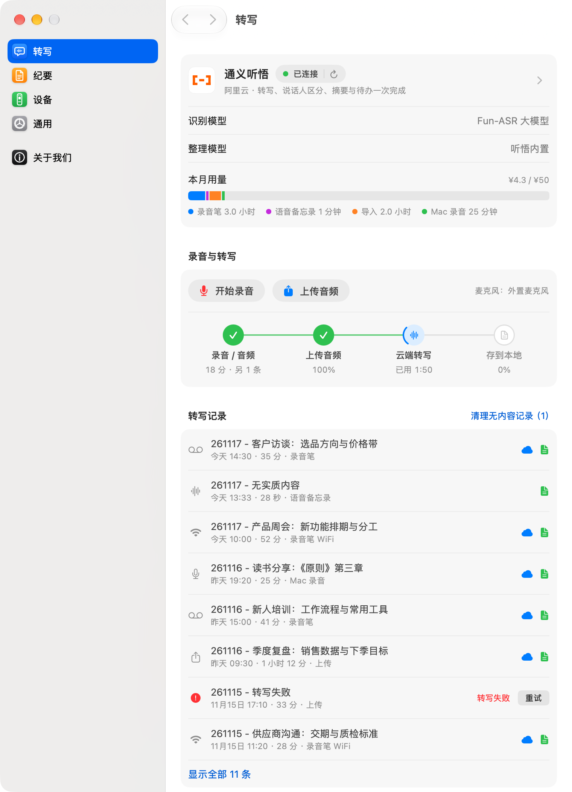
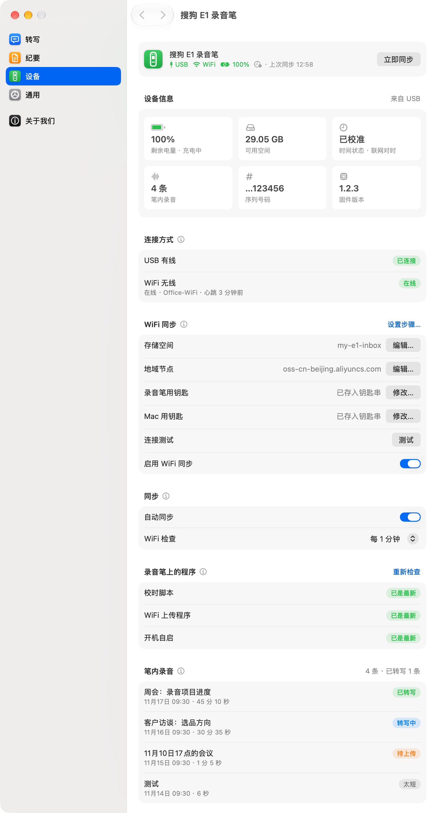

# 音录 yinloo

> 万物有声，皆可成文。官网和图文教程：[yinloo.com](https://yinloo.com)
>
> 项目原名「E1录音助手」，1.4.0 起应用也改叫「音录」，设置和记录都沿用。

让官方停服后的**搜狗 AI 录音笔 E1** 继续可用（1.5.0 起也支持 **C1 Max**）：录音自动从笔上到 Mac（USB 或 WiFi），在这台 Mac 上转成文字（1.5.0 起，免费、录音不上传），或交给你自己阿里云账号里的语音服务转写，再整理成会议纪要（Markdown / Word / PDF），存进你的笔记库或任意文件夹。

> 本项目与搜狗、阿里云均无关联。仓库里没有任何搜狗固件或服务端代码，也不连接搜狗的服务器；只处理**你自己这支笔**里的录音。

<p align="center">
  
  &nbsp;
  
</p>

## 能做什么

- **搜狗 C1 Max（1.5.0 起）**：用数据线连上就行，不用设置。音录以只读方式挂载，只拷录音，不改动笔上的文件；第一次插上时笔里已有的录音不自动转写，可在设备页逐条转写。
- **自动同步**：插上 USB 即拷贝新录音；设置 WiFi 同步后，笔连上网就把新录音传到你自己的阿里云 OSS「信箱」，Mac 开着时取回转写。同一条录音只转写一次，不会重复收费。
- **本机转写（1.5.0 起）**：用开源模型在这台 Mac 上转文字，录音不上传、不花钱。默认 X-ASR（中英混说、自带标点），也可选 Paraformer；模型第一次用时下载一次（约 136 MB 起），先走国内镜像，下完核对校验码。
- **云端转写**：通义听悟一次完成转写、说话人区分、摘要、待办、章节；也可选百炼语音（Fun-ASR），或任意 OpenAI 兼容接口。
- **两步分开选**：「① 转文字」和「② 整理成纪要」各自选本机或云端。整理可以交给千问、DeepSeek 或其他 OpenAI 兼容的大模型，只发文字、不发录音；没设置整理时只出逐字稿。
- **会议纪要**：内置 5 套模板（标准纪要、决策会议、访谈记录、课堂笔记、极简速记），也可用自己的模板；保存为 Markdown、Word 或 PDF。标题统一为「日期 - AI 标题」，例如「261112 - 新品发布会筹备与分工」。[看一份示例纪要](docs/示例纪要.md)。
- **Mac 录音与上传**：用 Mac 的麦克风直接录（可暂停），或上传本机音频文件，同样转写成纪要。
- **语音备忘录自动转写（可选）**：打开「偏好 › 设备 › 语音备忘录」后，Mac 上录的、iPhone 上录完经 iCloud 同步过来的新录音，停止约一分钟后自动转写。只读取，不改动语音备忘录；打开之前的录音不会自动转写。
- **笔端校时**：笔断电后时钟会乱，App 会在笔上装一个小脚本，联网后自动对时。
- **用量与预算**：按来源统计本月转写时长和估算费用，接近预算时提醒。
- **录音地点、发言人、热词**：给笔连过的 WiFi 起名（如「公司」「家」），纪要里写上地点；给发言人命名；常用人名和术语设为热词。
- **菜单栏常驻**：开机自动启动，不占程序坞；支持深色模式和读屏。

## 安装

1. 到[官网](https://yinloo.com)或 [Releases](../../releases) 下载最新的 `Yinloo-x.y.z.dmg`（1.3.2 及更早叫 `E1Recorder-x.y.z.dmg`），把应用拖进「应用程序」。
2. 第一次打开会被 macOS 拦住（应用未经 Apple 公证）：在提示里点「完成」，然后打开「系统设置 › 隐私与安全性」，在「安全性」一栏点「仍要打开」，再点一次「仍要打开」并输入登录密码。只需要这一次。[图文步骤](https://yinloo.com/install#gatekeeper)
3. 跟着引导设置，后三页都可以跳过：
   1. **怎么转文字**：默认「本机转写」，不用密钥，在这一页直接下载语音模型（约 136 MB）；没下完也能继续，录音先排队，下完自动转。也可以改选云端（通义听悟或百炼语音）：填百炼访问密钥（只存在本机钥匙串），通义听悟还要填应用编号（`tw_` 开头）；
   2. **整理成纪要（可选）**：填 DeepSeek 或千问的密钥，让大模型整理出摘要、要点和待办；也可以先不整理，只出逐字稿。在这页选纪要存放位置。以后都能在「偏好 › 转写 › 服务选项」里改；
   3. **设备（可选）**：有搜狗 E1 的，在笔上打开 adb（见下），用数据线连上 Mac，一键装上校时脚本；有 C1 Max 的，用数据线连上就行；用语音备忘录的，打开自动转写；
   4. **WiFi 同步（可选）**：按步骤创建自己的 OSS 存储空间和两把钥匙，再把上传程序装到笔上。

### 录音笔准备（只需一次）

在笔上打开 adb：**通用设置 → 关于本机 → 连续点「MAC 地址」→ 开发者模式 → 基本设置 → adb 打开**。之后插上 USB，App 就能读取录音。

装到笔上的程序（校时脚本、WiFi 上传程序、开机自启脚本）都内置在 App 里，只写在笔的数据分区 `/userdata`，不改系统和固件。它们的状态和更新都在「偏好 › 设备 › 搜狗 E1 录音笔 › 录音笔上的程序」。

<p align="center">
  
  &nbsp;
  
</p>

## 费用

本机转写免费。云端转写走你自己的阿里云账号，按量计费（2026 年 11 月价格）：通义听悟约 ¥0.79/小时（转写约 ¥0.6，摘要等分析约 ¥0.19），百炼语音约 ¥0.81/小时。整理成纪要交给千问或 DeepSeek 时，1 小时录音只要几分钱。OSS 信箱只临时放几天录音，费用可以忽略。建议在阿里云「费用中心」也设一个预算提醒。

## 隐私

- 访问密钥和 WiFi 钥匙只存在 macOS 钥匙串，不写进文件，导出配置时也不会带走。
- 选本机转写时，录音不离开这台 Mac；整理成纪要只把逐字稿的文字发给你选的大模型。
- 选云端转写时，录音只上传到你自己账号下的服务：通义听悟的临时存储（48 小时后自动删除）和你的 OSS 信箱（Mac 取回后即删除）。
- 笔上的钥匙只能上传，Mac 的钥匙只能读取和删除信箱这一个文件夹。
- 纪要只写在本机。「导出诊断信息」不含密钥、录音标题和网络名称。

## 已知局限

- 需要 macOS 15 或更新版本。本机转写不用账号；云端转写、整理成纪要要你自己的阿里云（或 DeepSeek 等）账号，不设置整理就只出逐字稿。
- 本机转写遇到离得远、声音小的说话可能漏字；每条转完会自查，漏得多会在纪要顶部提醒，要紧的录音可以改用云端转写。整理成纪要暂时还要用云端大模型，本机大模型还在做。
- 应用没有经过 Apple 公证：第一次打开要到「系统设置 › 隐私与安全性」里点「仍要打开」，每次升级后第一次启动会请求一次钥匙串授权。
- 录音笔息屏约 5 分钟后会休眠，WiFi 上传只在笔醒着时进行；长录音可能要等下次亮屏才传完，急用就插 USB。
- 识别出的有效文字不足 10 个字的录音不生成纪要，只留一条「无实质内容」记录，可一键清理。
- 通义听悟的热词需要在百炼控制台里设置；App 里的热词对百炼语音和自定义平台生效。
- 语音备忘录的存放位置苹果没有公开，系统升级后可能变化；macOS 可能要求在「完全磁盘访问权限」里打开本应用才能读取。
- C1 Max 只支持 USB，没有 WiFi 同步；电池不好的笔断电后时钟会停走或回到 2020 年，录音时间可能不准，请在笔的设置里重设时间。搜狗其他型号（C1、C1 Pro、S1 等）没见过实物，不保证能用。

## 从源码构建

需要 Xcode 26 或更新版本（编译 Icon Composer 图标）、`adb`（`brew install android-platform-tools`）和 Go（`brew install go`，编译笔上的上传程序）。本机转写用的 sherpa-onnx 动态库不在仓库里：第一次运行 `build.sh` 时从 sherpa-onnx 官方发布页下载，核对校验码后放进 `app/.vendor/`。

```bash
cd app
./build.sh                         # 产物在 app/build/：音录.app 和 Yinloo-版本.dmg（Apple 芯片与 Intel 通用）
swift test                         # 标题规则、文件命名、Markdown 导出、在线判定、模型下载、检查更新等单元测试（先跑过一次 build.sh）
(cd ../pen/e1wifi && go test .)    # 笔上上传程序的测试（模拟云端）
```

开发用：`PREVIEW=1 ./build.sh` 打出的版本支持截图模式，例如 `…/E1Recorder -uiPreview YES -previewDemo YES -previewSection platform`，全部使用虚构的示例数据，不读写真实设置和记录。钥匙串里有自签名的代码签名证书时（名字写在 `app/.signing-identity`），打包会用它签名。

## 目录

| 路径 | 内容 |
|---|---|
| `app/Sources/E1Recorder` | SwiftUI 菜单栏应用：`Pipeline*.swift` 同步与转写流程，`*Page.swift` 各设置页，`Migrations.swift` 一次性数据迁移，`Log.swift` 日志与诊断，`LocalASR.swift`、`SherpaEngine.swift`、`ModelDownloader.swift` 本机转写与模型下载，`C1Max*.swift` 搜狗 C1 Max（只读挂载、拷录音） |
| `app/Sources/YinlooASR` | 本机识别子程序 `yinloo-asr`：每转一条录音起一个，调用 sherpa-onnx，转完退出 |
| `app/Sources/LocalASRCore` | 主程序和子程序共用的部分：切段、分句、读 WAV、两边之间的消息格式 |
| `app/Tests` | 单元测试；`DemoNoteTests` 用应用自己的模板生成示例纪要 |
| `app/Resources` | 应用图标（Icon Composer 格式）及图层绘制脚本；`licenses/` 是随应用分发的第三方许可证和声明 |
| `pen/` | 装到录音笔上的程序：校时脚本 `e1sync.sh`、开机自启 `auto_reboot.sh`、WiFi 上传程序 `e1wifi/`（Go，含测试）。都只写 `/userdata` |
| `docs/` | 截图与示例纪要（全部是虚构数据） |

## 许可

MIT。应用内附带的第三方组件：`adb` 来自 Android 平台工具（Apache-2.0）；本机转写用的 [sherpa-onnx](https://github.com/k2-fsa/sherpa-onnx)（Apache-2.0）和它带的 [ONNX Runtime](https://onnxruntime.ai)（MIT，第三方组件声明见 `app/Resources/licenses/onnxruntime-ThirdPartyNotices.txt`）。语音模型不随应用分发，用到时从国内镜像或 sherpa-onnx 官方发布页下载，各自的许可写在「本机模型」页上。
